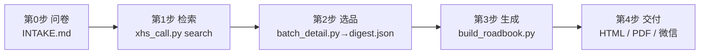

# 🔧 生成链（PIPELINE）

> 全链路：**第 0 步问卷 → 第 1 步检索 → 第 2 步选品 → 第 3 步生成 → 第 4 步 PDF/分发**
> 环境准备（小红书 MCP 服务、高德 MCP、Defender 排除等）见 [TOOLCHAIN.md](TOOLCHAIN.md)。



## 第 0 步 · 问卷（必做，已答项跳过）

按 [INTAKE.md](../INTAKE.md) 收齐 6 要素：**旅游时间 / 出发地与大交通 / 预计花费 / 人员构成 / 路线偏好 / 饮食偏好与忌口**。

- 用户提问时已给出的项直接采用，**不重复追问**
- 未回答的项按 INTAKE.md 默认假设走，并在交付物中声明"假设，可改"
- 事实类信息（班次/票价/场次）不假设，标"待确认"

产出：一组生成参数（`--date-range / --travelers / --budget / --preferences`）。

## 第 1 步 · 检索（需小红书 MCP 服务在跑）

```bash
python scripts/xhs_call.py login                                    # 确认登录态
python scripts/xhs_call.py search "潮汕4天3晚攻略" s_trip.json      # 每个方向 5-8 篇，取高赞
python scripts/xhs_call.py search "南澳岛自驾环岛" s_nanao.json
python scripts/xhs_call.py search "汕头美食避雷" s_shantou.json
# ...按目的地组合关键词：攻略/美食/避雷/自驾 至少四类
```

## 第 2 步 · 选品 + 批量详情

人工从 search 结果挑高赞、对口的笔记（潮汕实战标准：赞数优先、近一年发布、攻略/避雷/美食三类都要有），然后：

```bash
# 编辑 batch_detail.py 顶部的笔记清单（note_id + xsec_token + 输出名）后：
python scripts/batch_detail.py    # → scripts/digest.json + d_*.json
```

笔记 JSON 关键结构：`data.note.desc`（正文，店铺清单在这）、`data.note.imageList[].urlDefault`（webp 直链；**图序≈正文店铺序**）。

## 第 3 步 · 生成

```bash
python scripts/build_roadbook.py --no-images   # 先出无图版校对内容/动线
python scripts/build_roadbook.py \
  --date-range "..." --travelers "..." --budget "..." --preferences "..."   # 完整版（下载图+内嵌）
```

产出：`example/generated/潮汕4天3晚-不走回头路路书.html`（单文件，图片 base64 内嵌）+ 同名数据层 `tripData.json`。

**改内容改哪里**：店铺/景点/坐标/逐日时间线都是 `build_roadbook.py` 顶部的常量（`SHOPS` / `SCENIC` / `DAYS_MAP` / `TIMELINE`），改完重跑即可，不要手改 HTML 产物。

## 第 4 步 · 交付

```bash
# PDF（手机端友好；⚠️ html 附件在手机微信里不渲染，发微信用 PDF）
msedge --headless=new --no-pdf-header-footer --virtual-time-budget=30000 \
       --print-to-pdf="路书.pdf" "example/generated/潮汕4天3晚-不走回头路路书.html"
```

分发注意：
- 带**笔记实拍图**的完整版仅限个人/自用场景，**勿公开分发**（图版权归原作者）
- 公开仓库/对外分享一律用 `--no-images` 无图版
- 检索产物 `d_*.json / digest.json`（含 xsec_token）不随任何交付物外发

## 常见坑速查

| 坑 | 解法 |
|----|------|
| Leaflet 标记全部错位 | 点位是 `[名称,经度,纬度]`，Leaflet 要 `[纬度,经度]`——已内置换序，自己加点位时别改回去 |
| 地图瓦片 404 | 用 `wprd0{s}...style=8`（subdomains 1-4）；`webrd0{s}`+裸 style=7 是 404 方案 |
| 图片下载失败 | 带 UA + Referer `https://www.xiaohongshu.com/`；search 偶发超时换短词重试 |
| 无头截图瓦片灰块 | 多为截图抢跑，加大 `--virtual-time-budget` 复截 |
| 微信里 html 打不开 | 手机微信不预览 html 附件，转 PDF 发 |
| PDF 地图模糊 | 瓦片 256px 位图打印仅 ~100DPI——用脚本内置的静态高清地图（2000px 截图内嵌，print 时自动替换交互地图） |
| PDF 里链接点不动 | Edge print-to-pdf 会把 <a> 转 PDF 超链接注释（用 PyMuPDF get_links 验证）；笔记索引附录同时给 note_id 供 App 内搜索兜底 |
